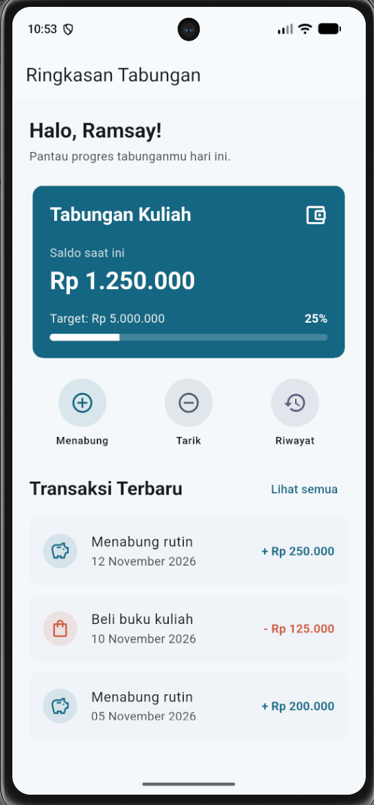
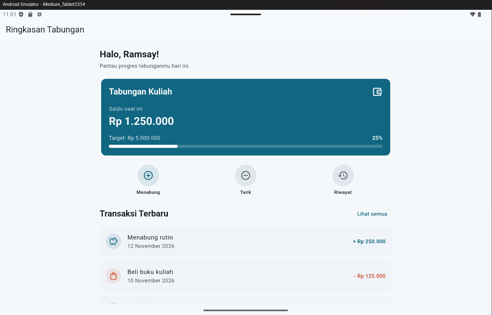

# TabungKu Layout

## Identitas

- Nama: Ramsay Abelson
- NIM: 20240801042
- Mata kuliah: TI505 Pemrograman Mobile
- Pertemuan: 3
- Sub-CPMK: Sub-CPMK-1.1

## Judul dan Bobot Tugas

**Membangun Form Input dan Pengelolaan State dengan GetX**  
Tugas Minggu 3: **Menyusun Layout dengan Widget Dasar Flutter**

- Rubrik analitik: 5% nilai akhir
- Bobot tugas: 15%

## Konteks

Aplikasi TabungKu membutuhkan layar utama yang rapi sebelum fitur formulir dan
data dikembangkan. Proyek ini menyusun layar **Ringkasan Tabungan** menggunakan
widget dasar Flutter.

## Implementasi

Halaman pada `lib/main.dart` memenuhi rancangan berikut:

- `Scaffold` dengan `AppBar` berjudul **Ringkasan Tabungan**.
- Satu `Card` berisi nama tabungan, saldo, target, dan progres yang disusun
  menggunakan `Column` dan `Row`.
- Satu baris berisi tiga tombol atau ikon kategori: **Menabung**, **Tarik**,
  dan **Riwayat**.
- Daftar sederhana berisi minimal tiga transaksi. Setiap transaksi menampilkan
  judul, tanggal, dan nominal.
- Pengaturan jarak dan posisi menggunakan `Padding`, `Container`, `SizedBox`,
  `alignment`, `mainAxisAlignment`, dan `crossAxisAlignment`.
- Konten dibungkus dengan layout responsif dan dapat digulir agar tidak
  overflow pada layar ponsel potret maupun tablet.

## Langkah Pengerjaan

1. Membuat project Flutter bernama `tabungku_layout`.
2. Membuat satu halaman `RingkasanPage` pada `lib/main.dart`.
3. Menambahkan `Scaffold`, `AppBar`, kartu ringkasan, baris kategori, dan daftar
   transaksi.
4. Mengatur hierarki widget, jarak, perataan, dan ukuran elemen.
5. Menguji layout pada ukuran layar ponsel dan tablet.
6. Mengambil dua tangkapan layar hasil aplikasi untuk dokumentasi.

## Ketentuan yang Dipenuhi

- Hanya menggunakan widget dasar Flutter yang dipelajari pada Pertemuan 1 dan
  2; tidak menambahkan paket pihak ketiga untuk layout.
- Data transaksi menggunakan data statis (hard-coded).
- Kode dapat dijalankan dengan `flutter run`.
- Setiap bagian kode yang menyusun layout memiliki komentar singkat.
- Pengerjaan dibuat secara individu.

## Cara Menjalankan

Jalankan perintah berikut dari folder `tabungku_layout`:

```bash
flutter pub get
flutter run
```

Untuk memeriksa format, analisis, dan test:

```bash
dart format lib/main.dart test/widget_test.dart
flutter analyze
flutter test
```

Untuk menjalankan pada emulator tablet, pilih atau buat perangkat tablet
melalui Android Studio Device Manager, kemudian jalankan:

```bash
flutter devices
flutter run -d <device_id_tablet>
```

## Dokumentasi Tangkapan Layar

Tugas mensyaratkan dua tangkapan layar pada ukuran berbeda. Bukti yang tersedia
di repository ini:

#### Layar Ponsel Potret



#### Layar Tablet atau Lebih Lebar



Kedua tangkapan layar harus menunjukkan hasil layout dengan jelas dan tidak
mengalami overflow.
